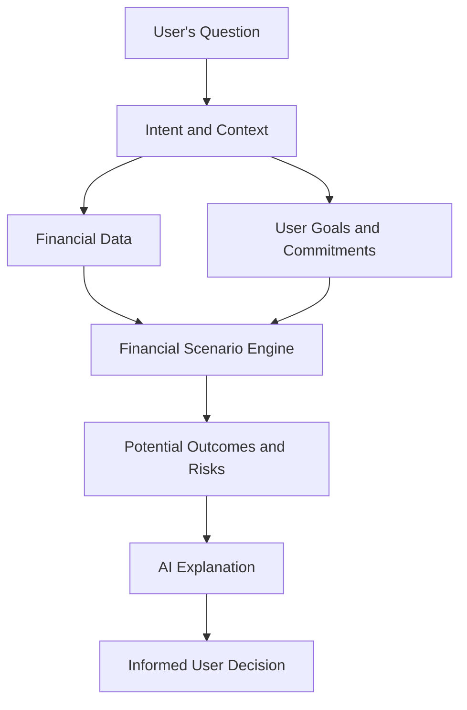

# UGODAI Wallet

Know before you spend!    

**UGODAI Wallet** is an AI-powered financial companion that helps you understand the consequences of your financial decisions before you make them.     

A balance tells you how much money you have. UGODAI helps you understand what spending that money could mean for you.

## The idea

Can I afford this purchase right now?

Not just according to my current balance, but considering my upcoming expenses, financial commitments, goals, and uncertainty about future income?

**UGODAI Wallet** aims to answer this question by bringing financial data and personal context together.

Instead of merely tracking transactions, it helps users evaluate financial decisions before committing to them.

## Core principles

* **Context over balance** — available funds are only one part of a financial decision.
* **Informed autonomy** — help users make their own decisions rather than make decisions for them.
* **Consequences over commands** — explain potential outcomes, trade-offs, and risks instead of issuing unexplained verdicts.
* **Deterministic calculations** — financial calculations should be reproducible, explicit, and independently testable.
* **AI-assisted understanding** — use AI to interpret user intent, understand context, and explain financial scenarios.
* **Privacy by design** — minimize data collection and protect sensitive financial information.
* **Transparency over false certainty** — distinguish known facts, assumptions, estimates, and unknowns.

## How it works

**UGODAI Wallet** is envisioned as a conversational interface backed by a financial decision-support engine.

The architecture separates financial computation from AI-generated explanations.

The financial engine evaluates balances, commitments, spending limits, and hypothetical scenarios. AI helps interpret the user’s question and communicate the results in understandable language.

AI-generated explanations must not replace the underlying calculations or conceal uncertainty.

### Example

You ask:

Can I afford a $2,000 laptop right now?

**UGODAI Wallet** considers the available financial information and your stated commitments.

It might explain:

* How much money would remain after the purchase.
* Whether upcoming expenses could be affected.
* How the purchase would change your financial reserves.
* Which assumptions or missing information could change the assessment.
* What alternatives could better align with your financial goals.

The goal is not to tell you what you are allowed to buy.

The goal is to help you understand the consequences before you decide.

Recommendations depend on the completeness and accuracy of the available information. UGODAI cannot guarantee future financial outcomes.

### What makes UGODAI different?

Traditional wallets primarily help you store, transfer, and manage money.

Budgeting applications help you track spending and plan expenses.

**UGODAI Wallet** focuses on a different question:

How does this financial decision fit into the bigger picture of my life?

The long-term vision is contextual financial intelligence: helping people understand how individual decisions interact with their goals, obligations, and future options.

## Project status

**UGODAI Wallet** is an evolving project.

The initial focus is defining the product’s principles, financial decision model, and technical architecture.

Potential areas of development include:

* Conversational financial assistance.
* Context-aware spending assessments.
* Financial commitments and goal tracking.
* Deterministic financial scenario calculations.
* Explainable recommendations with explicit assumptions.
* Integration with cryptocurrency wallets and financial data sources.
* User-defined financial preferences and spending constraints.

These are development directions, not claims that the features are already implemented.

## Design philosophy

**UGODAI Wallet** should support financial autonomy, not replace it.

It should not shame users for their spending choices, manipulate them into specific purchases, or present uncertain predictions as facts.

The user remains in control.

Financial recommendations should be understandable, traceable to their underlying data, and proportionate to the uncertainty involved.

## Security and privacy

Financial data requires particular care.

The project aims to follow these principles:

* Collect only the information necessary for the requested functionality.
* Keep sensitive financial data under the user’s control wherever possible.
* Never expose private keys, seed phrases, or wallet credentials to an AI model.
* Separate transaction authorization from AI-generated recommendations.
* Require explicit authorization for transactions and other consequential actions.
* Make the assumptions and limitations of financial assessments visible.

These principles describe the intended design direction and do not imply that any particular security control has already been implemented or audited.

## Responsible AI and EU AI Act

UGODAI Wallet is being designed with transparency, user autonomy,
privacy, and accountability as core principles.

The project aims to align its AI system design and development
practices with applicable European Union requirements, including
Regulation (EU) 2024/1689 (the EU Artificial Intelligence Act).

#### Intended use

The initial product scope focuses on personal financial
decision support, including expense planning, financial scenario
analysis, and explanations of potential spending consequences.

UGODAI Wallet is not intended to make lending decisions, assign
creditworthiness scores, or determine eligibility for financial
services as part of its initial scope.

Any expansion into these or other regulated use cases requires
a separate assessment of the applicable legal and regulatory
requirements.

#### Transparency

Users should be clearly informed when they interact with an
AI-powered assistant, where required by applicable law.

AI-generated explanations should distinguish available facts,
calculated results, assumptions, estimates, and uncertainties.

The application should not present hypothetical scenarios
or uncertain predictions as guaranteed financial outcomes.

#### Human autonomy

UGODAI Wallet is designed to support informed financial decisions,
not to replace the user's judgment.

Financial recommendations should explain their reasoning and
relevant limitations. Users should remain in control of their
financial choices.

AI-generated recommendations must not independently authorise
financial transactions.

#### Reliability and accountability

Financial calculations should be performed by explicit,
testable components rather than relying exclusively on
language-model outputs.

The system should preserve sufficient information to explain
how a recommendation was produced, subject to applicable
privacy and data-protection requirements.

Material limitations, missing data, and assumptions should
be communicated to users when relevant to a decision.

#### Privacy and data protection

The project aims to follow privacy-by-design and data-minimisation
principles.

Personal financial data should be processed only for defined
purposes, with appropriate safeguards and retention practices.

The applicable data-protection requirements must be assessed
before processing personal data in production.

#### Compliance status

These principles describe the project's intended design direction.
They do not constitute a declaration that the software complies
with the EU AI Act, GDPR, or other applicable laws.

Regulatory obligations depend on the implemented functionality,
the system's intended purpose, the roles of the relevant parties,
and the circumstances in which the system is deployed.

Compliance must be assessed and verified before the relevant
functionality is placed on the market or put into service.

## Disclaimer

**UGODAI Wallet** is intended to support financial awareness and decision-making.

Its assessments are based on available data and explicit assumptions. They may be incomplete or inaccurate and are not guarantees of future outcomes.

Users remain responsible for their financial decisions. The product’s eventual functionality and applicable regulatory requirements will determine the scope of any additional financial disclosures.

## Vision

A financial wallet should do more than tell you what you have.

It should help you understand what you can do, what you might risk, and how today’s decisions affect tomorrow’s possibilities.

**UGODAI — Know before you spend!**

## License

**UGODAI Wallet** is licensed under the [Apache License 2.0](LICENSE).    
Copyright &copy; 2026 UGODAI
